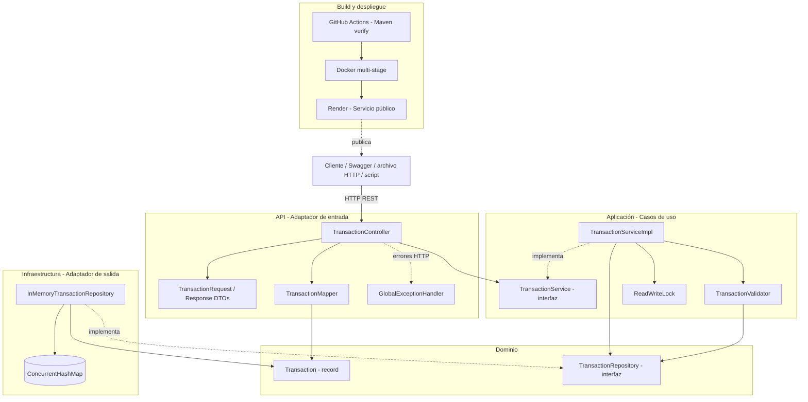
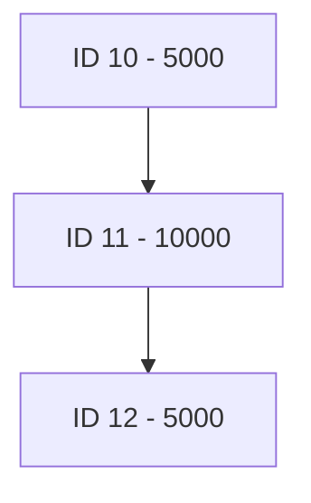
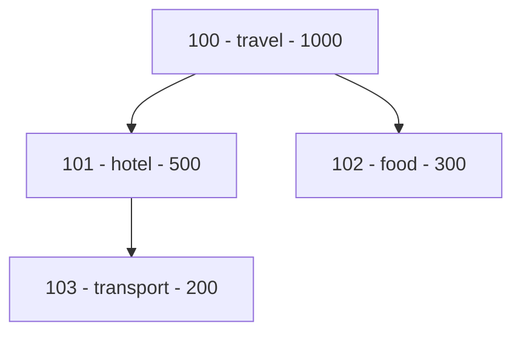

# Transaction Management API

   

API REST desarrollada en **Java 21 y Spring Boot**. Almacena transacciones en memoria, permite consultar sus identificadores por tipo y calcula la suma de una transacción junto con todos sus descendientes, incluso cuando existen varios niveles de relación.

> **Probar sin instalar nada:** [Abrir Swagger UI desplegado en Render](https://transaction-management-api-7yr8.onrender.com/swagger-ui/index.html).
>
> El servicio de demostración utiliza un plan gratuito y puede tardar en responder después de un período de inactividad. Al reiniciarse el proceso se pierden las transacciones almacenadas en memoria.

## Contenido

1. [Demostración y enlaces](#demostración-y-enlaces)
2. [Requerimientos y contrato HTTP](#requerimientos-y-contrato-http)
3. [Arquitectura y diagrama del sistema](#arquitectura-y-diagrama-del-sistema)
4. [Tecnologías y estructura](#tecnologías-y-estructura)
5. [Ejecución local](#ejecución-local)
6. [Ejecución con Docker](#ejecución-con-docker)
7. [Cómo probar la API con Swagger](#cómo-probar-la-api-con-swagger)
8. [Ejemplos oficiales](#ejemplos-oficiales)
9. [Escenarios adicionales](#escenarios-adicionales)
10. [Archivos HTTP y script PowerShell](#archivos-http-y-script-powershell)
11. [Validaciones y manejo de errores](#validaciones-y-manejo-de-errores)
12. [Tests e integración continua](#tests-e-integración-continua)
13. [Decisiones de diseño y limitaciones](#decisiones-de-diseño-y-limitaciones)

## Demostración y enlaces

| Recurso | URL |
|---|---|
| **Swagger UI público** | [Abrir documentación y probar endpoints](https://transaction-management-api-7yr8.onrender.com/swagger-ui/index.html) |
| **OpenAPI JSON** | [Ver especificación](https://transaction-management-api-7yr8.onrender.com/v3/api-docs) |
| **Health check** | [Ver estado de la aplicación](https://transaction-management-api-7yr8.onrender.com/actuator/health) |
| Swagger UI local | http://localhost:8080/swagger-ui/index.html |
| Health check local | http://localhost:8080/actuator/health |

La ruta raíz (`/`) no tiene un endpoint implementado; una respuesta **404 en la raíz es normal**. Para interactuar con el servicio utilizá Swagger o las rutas de la API.

## Requerimientos y contrato HTTP

Se solicita un servicio web RESTful, implementado con Spring Boot, **sin SQL**, con **tests de integración** y **Docker**.

Una transacción posee los siguientes campos:

| Campo | Tipo | Ubicación | Descripción |
|---|---|---|---|
| `id` | `long` | Ruta | Identificador proporcionado por el cliente |
| `amount` | `double` | Cuerpo JSON | Monto de la transacción |
| `type` | `string` | Cuerpo JSON | Tipo de transacción |
| `parent_id` | `long`, opcional | Cuerpo JSON | Identificador de la transacción padre |

> El `amount` se representa como `double` en el modelo de dominio para respetar el tipo especificado. El DTO de entrada puede usar el tipo envoltorio `Double` para detectar cuando se omite el campo.

| Método | Ruta | Función | Respuesta exitosa |
|---|---|---|---|
| `PUT` | `/transactions/{id}` | Crear o reemplazar una transacción | `200` — `{"status":"ok"}` |
| `GET` | `/transactions/types/{type}` | Listar los IDs de un tipo | `200` — `[10,11]` |
| `GET` | `/transactions/sum/{id}` | Sumar la transacción y sus descendientes | `200` — `{"sum":20000.0}` |

Se mantienen las **rutas exactas del enunciado** (`/transactions/...`) en lugar de introducir `/api` o `/api/v1`, para respetar el contrato esperado por los consumidores y posibles evaluaciones automatizadas.

## Arquitectura y diagrama del sistema

Se implementó una **arquitectura hexagonal ligera**, organizada por funcionalidad. La capa HTTP adapta requests y responses; la aplicación ejecuta casos de uso; el dominio contiene el modelo y los contratos; y la infraestructura implementa el almacenamiento en memoria.



### Flujo de un `PUT`

1. `TransactionController` recibe el ID en la ruta y `TransactionRequest` en el cuerpo.
2. Jakarta Validation comprueba los campos requeridos y `TransactionMapper` crea el modelo `Transaction`.
3. El servicio toma un **bloqueo de escritura**, ejecuta `TransactionValidator` y, si es válido, guarda mediante `TransactionRepository`.
4. `InMemoryTransactionRepository` almacena o reemplaza el registro por ID.
5. Se devuelve `{"status":"ok"}`. Ante una validación fallida, `GlobalExceptionHandler` transforma la excepción en una respuesta HTTP controlada.

### ¿Cómo se calcula la suma transitiva?

El servicio obtiene la transacción raíz, construye un índice temporal **padre → hijos** y recorre el subárbol mediante **DFS iterativo** (pila `ArrayDeque`). Un conjunto de IDs visitados evita contabilizar nodos repetidos.



- `sum(10) = 5000 + 10000 + 5000 = 20000`
- `sum(11) = 10000 + 5000 = 15000`

Con `n` transacciones totales, reconstruir el índice y recorrer los descendientes cuesta **O(n)** en tiempo y **O(n)** en espacio en el peor caso. La búsqueda por ID en el mapa es **O(1) esperado**. Las relaciones cíclicas se rechazan al guardar.

## Tecnologías y estructura

- **Java 21**, **Spring Boot 4.x**, **Spring Web MVC**, **Jakarta Validation**.
- **Maven Wrapper** para builds reproducibles.
- **ConcurrentHashMap** para almacenamiento temporal.
- **ReadWriteLock** para coordinar las operaciones desde el servicio.
- **Springdoc OpenAPI / Swagger UI** para documentación interactiva.
- **JUnit Jupiter y Mockito** para tests unitarios; **Spring Boot Test + MockMvc** para integración.
- **Docker**, **Docker Compose**, **GitHub Actions** y **Render**.

Estructura principal (resumida):

```text
transaction-management-api/
├── .github/workflows/ci.yml
├── http/
│   ├── mendel-examples.http
│   └── additional-scenarios.http
├── scripts/run-api-examples.ps1
├── src/
│   ├── main/java/com/transactionmanagement/api/
│   │   ├── TransactionManagementApiApplication.java
│   │   ├── shared/exception/
│   │   └── transaction/
│   │       ├── api/                 # controller, DTOs, mapper, configuración OpenAPI
│   │       ├── application/         # interfaz/implementación service, validator
│   │       ├── domain/              # modelo y contrato repository
│   │       └── infrastructure/      # repository en memoria
│   └── test/java/                  # tests unitarios e integración
├── Dockerfile
├── .dockerignore
├── compose.yml
├── mvnw
├── mvnw.cmd
├── pom.xml
└── README.md
```

## Ejecución local

**Requisitos:** Java 21 instalado y acceso a las dependencias de Maven. No es necesario instalar Maven globalmente: el proyecto incluye Maven Wrapper.

Cloná el repositorio desde GitHub (según los permisos proporcionados al evaluador) y situate en la raíz:

```bash
cd transaction-management-api
```

**Windows / PowerShell:**

```powershell
.\mvnw.cmd spring-boot:run
```

**Linux / macOS:**

```bash
./mvnw spring-boot:run
```

La aplicación estará disponible por defecto en `http://localhost:8080`. Comprobá:

```text
http://localhost:8080/actuator/health
http://localhost:8080/swagger-ui/index.html
```

El health check debe devolver un JSON similar a `{"status":"UP"}`. En IntelliJ IDEA también puede ejecutarse `TransactionManagementApiApplication` directamente.

> Si el puerto 8080 está ocupado, detené la aplicación local o el contenedor que ya lo esté utilizando; no intentes iniciar ambas instancias en el mismo puerto.

## Ejecución con Docker

**Requisito:** Docker Desktop o Docker Engine con Docker Compose.

Desde la raíz del repositorio:

```bash
docker compose up --build -d
```

Verificá el estado y los logs:

```bash
docker compose ps
docker compose logs -f transaction-api
```

Abrí [Swagger local](http://localhost:8080/swagger-ui/index.html) o el [health check local](http://localhost:8080/actuator/health).

Para detener el servicio:

```bash
docker compose down
```

Para volver a construirlo tras cambios de código:

```bash
docker compose up --build -d
```

El **Dockerfile multi-stage** compila con JDK 21 y Maven, y ejecuta el JAR en una imagen final con JRE 21, bajo un usuario no privilegiado. Docker Compose expone el puerto `8080`.

**La aplicación no necesita base de datos externa:** el repositorio persiste en memoria dentro del proceso. Al reiniciar o recrear el contenedor, las transacciones se pierden.

## Cómo probar la API con Swagger

Elegí una de las interfaces:

- **Pública:** https://transaction-management-api-7yr8.onrender.com/swagger-ui/index.html
- **Local:** http://localhost:8080/swagger-ui/index.html

Para crear una transacción:

1. Expandí **`PUT /transactions/{id}`**.
2. Presioná **Try it out**.
3. Completá el parámetro `id`.
4. Pegá el cuerpo JSON y presioná **Execute**.
5. Verificá la respuesta `200` con `{"status":"ok"}`.

Después expandí **`GET /transactions/types/{type}`** o **`GET /transactions/sum/{id}`**, completá el parámetro correspondiente y ejecutá la consulta.

> En Render Free, el primer acceso puede tardar mientras se reactiva la instancia. Los datos de ejemplo solo permanecen hasta el siguiente reinicio del proceso. Para obtener resultados idénticos, probá desde una instancia limpia y ejecutá las operaciones en orden.

## Ejemplos oficiales

Los siguientes son los ejemplos del enunciado y también están disponibles en `http/mendel-examples.http`.

### Paso 1: crear la raíz

**PUT** `/transactions/10`

```json
{
  "amount": 5000,
  "type": "cars"
}
```

### Paso 2: crear una hija de la 10

**PUT** `/transactions/11`

```json
{
  "amount": 10000,
  "type": "shopping",
  "parent_id": 10
}
```

### Paso 3: crear una hija de la 11

**PUT** `/transactions/12`

```json
{
  "amount": 5000,
  "type": "shopping",
  "parent_id": 11
}
```

Cada `PUT` exitoso devuelve:

```json
{"status":"ok"}
```

### Verificar los resultados

| Consulta | Respuesta esperada |
|---|---|
| `GET /transactions/types/cars` | `[10]` |
| `GET /transactions/sum/10` | `{"sum":20000.0}` |
| `GET /transactions/sum/11` | `{"sum":15000.0}` |

El ejemplo demuestra que la suma incluye **descendientes indirectos**: aunque la 12 no es hija directa de la 10, participa en su total.

## Escenarios adicionales

Para ampliar la verificación se incorporó `http/additional-scenarios.http` y un script ejecutable que cubre los escenarios siguientes. Ejecutá los PUT en orden y utilizá los IDs indicados para no mezclar ejemplos.

### A. Árbol con múltiples ramas

| ID | Monto | Tipo | Padre |
|---|---:|---|---|
| 100 | 1000 | travel | — |
| 101 | 500 | hotel | 100 |
| 102 | 300 | food | 100 |
| 103 | 200 | transport | 101 |



**Qué comprueba:** recorrido de múltiples ramas, descendientes a diferentes niveles y filtrado por tipo.

**Resultados:** `sum/100 = 2000`, `sum/101 = 700` y `types/hotel = [101]`.

### B. Actualización sin duplicación

1. Crear `PUT /transactions/200` con `{"amount":500,"type":"office"}`.
2. Consultar `GET /transactions/sum/200` → `{"sum":500.0}`.
3. Repetir `PUT /transactions/200` con `{"amount":900,"type":"office"}`.
4. Consultar nuevamente → `{"sum":900.0}`.

**Qué comprueba:** reemplazo por ID, sin insertar una segunda transacción. Reenviar un PUT con el mismo estado produce el mismo resultado almacenado.

### C. Rechazo de un ciclo indirecto

Crear estas transacciones:

| ID | Monto | Padre |
|---|---:|---|
| 300 | 100 | — |
| 301 | 200 | 300 |
| 302 | 300 | 301 |

Después intentar actualizar **`PUT /transactions/300`** con:

```json
{
  "amount": 100,
  "type": "equipment",
  "parent_id": 302
}
```

**Resultado esperado:** HTTP `400` por relación circular. La consulta posterior `GET /transactions/sum/300` debe continuar devolviendo `{"sum":600.0}`.

**Qué comprueba:** detección de ciclos y que una actualización rechazada no altera el estado previamente almacenado.

### D. Validaciones y consultas sin resultados

| Petición | Resultado esperado | Qué comprueba |
|---|---|---|
| `PUT /transactions/400` con `parent_id: 999999` | `400` | No se permiten padres inexistentes |
| `PUT /transactions/401` con `type: ""` | `400` | Tipo obligatorio y no vacío |
| `PUT /transactions/402` sin `amount` | `400` | Monto obligatorio |
| `GET /transactions/sum/999999` | `404` | Recurso inexistente |
| `GET /transactions/types/unknown-category` | `[]` | Tipo sin coincidencias |

### E. Otros casos comprobados durante el desarrollo

- **Cambio de padre:** mover una transacción con descendientes entre árboles actualiza las sumas sin perder sus hijos.
- **Autorreferencia y ciclos:** no se admiten relaciones circulares.
- **Montos negativos y cero:** están admitidos conforme a las reglas de negocio adoptadas.
- **Overflow de `double`:** si el acumulado deja de ser finito, la API devuelve `422` con un error controlado.
- **ID inválido:** se devuelve `400`, incluido cuando el parámetro no se puede convertir a número o incumple la regla de positividad.

## Archivos HTTP y script PowerShell

### Colecciones `.http`

Los archivos `http/mendel-examples.http` y `http/additional-scenarios.http` permiten ejecutar cada petición individualmente desde el **HTTP Client de IntelliJ IDEA** (ícono de ejecución junto a la solicitud). Las operaciones que referencian padres deben ejecutarse después de crear las transacciones padre.

### Script automático

El script `scripts/run-api-examples.ps1` ejecuta los ejemplos oficiales y adicionales, comprueba códigos HTTP y compara los resultados esperados. Se ejecuta desde la **raíz del proyecto** en Windows, con la API funcionando en el puerto 8080:

```powershell
powershell -NoProfile -ExecutionPolicy Bypass -File .\scripts\run-api-examples.ps1
```

Para apuntar a otra URL, el script admite `-BaseUrl`:

```powershell
powershell -NoProfile -ExecutionPolicy Bypass -File .\scripts\run-api-examples.ps1 -BaseUrl "http://localhost:8080"
```

No ejecutes el script contra una API compartida con datos que deban conservarse: **realiza PUT sobre IDs fijos y puede reemplazar transacciones existentes**.

**¿Qué verifica?** Nueve escenarios: ejemplo oficial, árbol con ramas, actualización, ciclo rechazado, padre inexistente, tipo vacío, monto ausente, suma de ID inexistente y tipo sin coincidencias.

Salida esperada:

```text
OFFICIAL EXAMPLES
[PASS] Official transactions and sums

ADDITIONAL SCENARIOS
[PASS] Multiple branches
[PASS] Update existing transaction
[PASS] Circular relationship rejected
[PASS] Missing parent rejected
[PASS] Blank type rejected
[PASS] Missing amount rejected
[PASS] Unknown transaction returns 404
[PASS] Unknown type returns empty list

------------------------------
Passed: 9
Failed: 0
------------------------------
All scenarios passed!
```

El script devuelve código de salida **1** si algún escenario falla, y **0** si todos pasan. Los valores anteriores son el resultado esperado; el resultado efectivo depende del estado del servicio al ejecutarlo.

## Validaciones y manejo de errores

El sistema combina validaciones de request con reglas de integridad de las relaciones. `GlobalExceptionHandler` traduce excepciones controladas a respuestas HTTP JSON.

| Situación | HTTP |
|---|---:|
| Guardado exitoso | `200` |
| Consulta por tipo sin resultados | `200` con `[]` |
| Campos obligatorios ausentes o inválidos | `400` |
| Padre inexistente o ciclo detectado | `400` |
| ID inválido | `400` |
| Suma de transacción inexistente | `404` |
| Suma fuera del rango numérico representable | `422` |

Ejemplo de error controlado:

```json
{
  "error": "Invalid request parameters"
}
```

Los textos concretos pueden variar según la validación; las respuestas controladas mantienen la propiedad `error`.

## Tests e integración continua

De acuerdo con la última ejecución informada durante el desarrollo, **Maven ejecutó 93 tests, todos exitosos, sin errores ni tests omitidos**. Se incluyen tests unitarios, pruebas REST de integración, casos de contrato HTTP y tres escenarios de concurrencia.

### Ejecutar la suite

**Windows:**

```powershell
.\mvnw.cmd clean verify
```

**Linux / macOS:**

```bash
./mvnw clean verify
```

Los tests unitarios comprueban el validator, los casos de uso, el repositorio y el mapper. Los de integración cargan Spring Boot y usan MockMvc con los componentes reales de persistencia en memoria, verificando códigos HTTP, cuerpos JSON, relaciones padre-hijo, sumas, validaciones y concurrencia.

### GitHub Actions

El workflow `.github/workflows/ci.yml` ejecuta un build con Java 21 y Maven en cada **push** o **pull request** dirigido a `master`. El comando principal es:

```bash
./mvnw --batch-mode --no-transfer-progress clean verify
```

La ejecución del workflow fue comprobada durante el desarrollo. Los commits siguen la convención **Conventional Commits** (`feat:`, `fix:`, `test:`, `refactor:`, `docs:`, `ci:` y `chore:`).

## Decisiones de diseño y limitaciones

| Decisión | Motivo / compromiso |
|---|---|
| Mantener `/transactions` | Respeta exactamente las rutas requeridas. |
| Usar `double` | Cumple el contrato solicitado; no ofrece precisión decimal exacta para finanzas. |
| Repositorio como interfaz | Desacopla los casos de uso de `ConcurrentHashMap`. |
| DTOs separados del dominio | Distingue el contrato HTTP de los datos del negocio. |
| Validator dedicado | Comprueba integridad referencial y evita relaciones circulares. |
| `ReadWriteLock` | Coordina validación/guardado y lecturas dentro de la instancia del servicio. |
| DFS iterativo | Evita desbordamiento de la pila de llamadas en grafos profundos. |
| Sin base de datos externa | Cumple el requisito de no usar SQL y mantiene el despliegue autónomo. |

### Limitaciones conocidas

- **Persistencia efímera:** toda la información se pierde al reiniciar el proceso o contenedor.
- **Render Free:** el servicio puede suspenderse por inactividad y requerir tiempo de arranque.
- **Demostración sin autenticación:** los endpoints son públicos; no se deben utilizar para datos financieros reales ni información confidencial.
- **`double`:** existen límites de precisión; el overflow se controla, pero el resultado puede depender del orden de acumulación.
- **Concurrencia local:** el bloqueo protege las operaciones coordinadas por una instancia del servicio; no es un mecanismo distribuido para múltiples instancias.
- **Consultas O(n):** las búsquedas por tipo y las sumas recorren estructuras en memoria; no se mantienen índices secundarios persistentes.

### Posibles evoluciones

En un entorno productivo sería razonable evaluar almacenamiento duradero, precisión monetaria decimal (`BigDecimal`), índices por tipo y padre, versionado de API, seguridad/autorización, observabilidad, pruebas de carga y estrategias para despliegues con múltiples instancias. Estas mejoras **no forman parte del contrato implementado**.

---

El objetivo es demostrar diseño de API REST, modelado de relaciones, algoritmos de grafos, validaciones, testing, automatización y despliegue.
